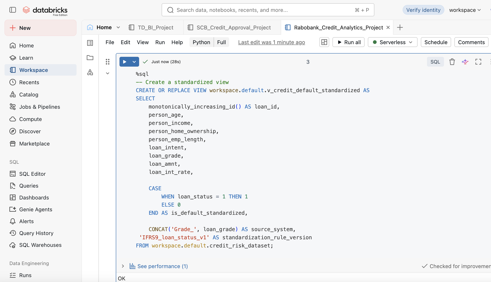
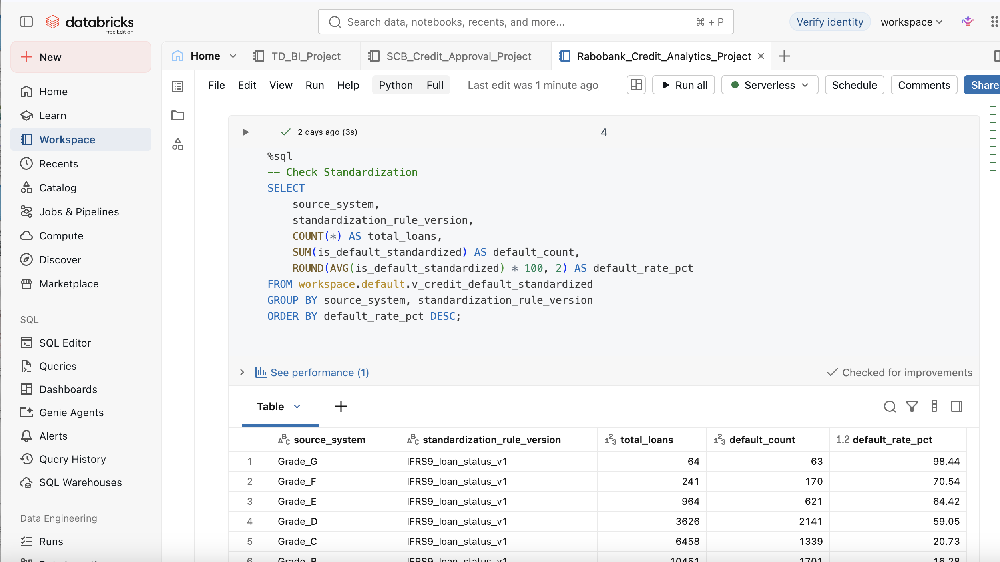
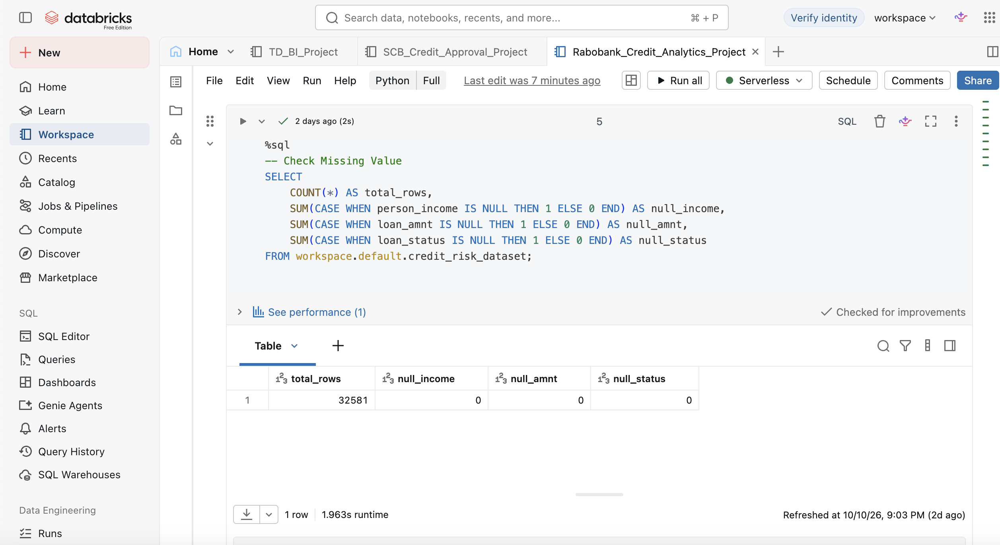
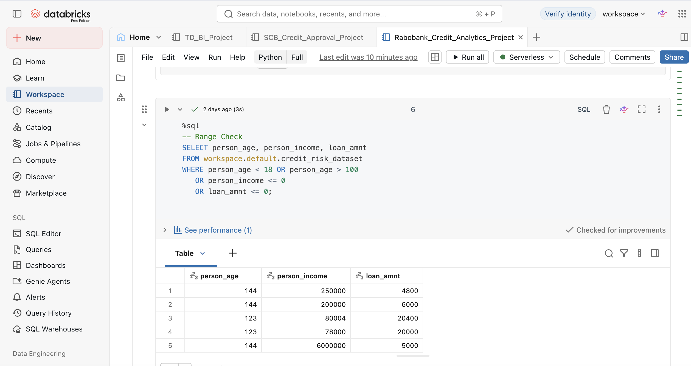
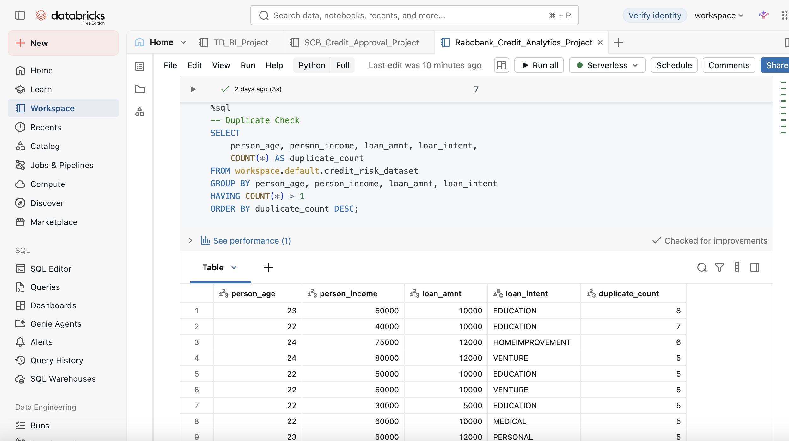
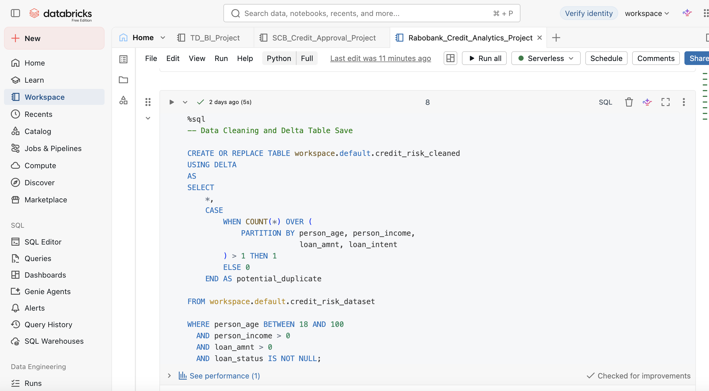
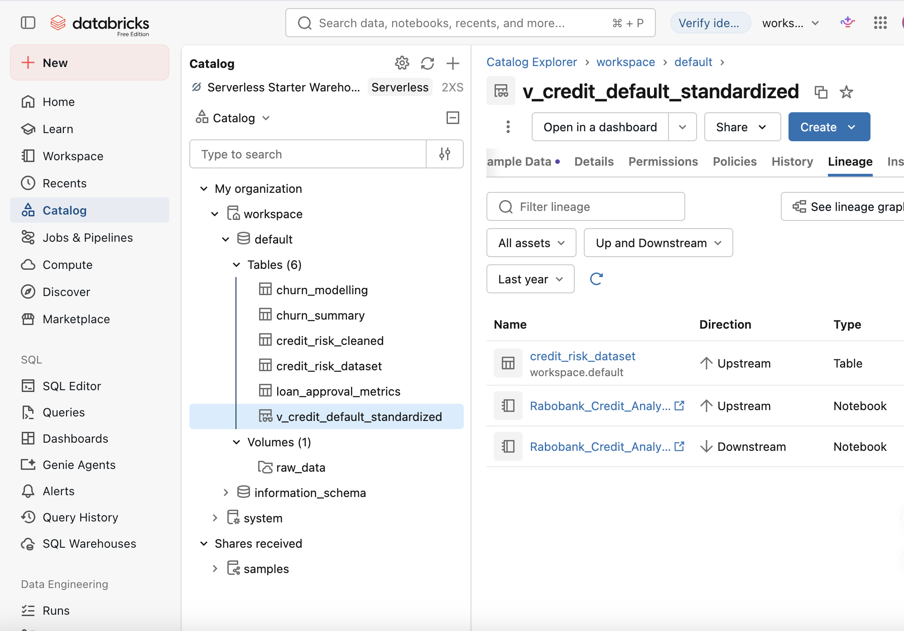

# Databricks-Credit-Risk-Lakehouse

## Project Introduction
This project is inspired by Rabobank's credit analytics case, focusing on data cleaning, standardization, and governance using Databricks, Unity Catalog, and Delta Lake.

## Data Source

- Kaggle: Credit Risk Dataset
- Link: https://www.kaggle.com/datasets/laotse/credit-risk-dataset
- Records: 32,581 loan records
- Key Fields:
  - `person_age`: Applicant's age
  - `person_income`: Applicant's annual income
  - `person_home_ownership`: Home ownership status
  - `loan_intent`: Purpose of the loan
  - `loan_grade`: Loan risk grade (A–G)
  - `loan_amnt`: Requested loan amount
  - `loan_int_rate`: Loan interest rate
  - `loan_status`: Loan default status (0 = Non-default, 1 = Default)

The credit risk dataset was uploaded to a Databricks Unity Catalog Volume and saved as a table. SQL was used to standardize loan default definitions, check data quality, and clean the dataset. The cleaned data was saved as a Delta Table, and Unity Catalog was used to explore data lineage.

## Tools

- Databricks Free Edition
- SQL
- PySpark
- Delta Lake
- Unity Catalog

## Analysis Process

1. Upload the raw CSV dataset to a Unity Catalog Volume.
2. Read the dataset into Databricks and register it as a table.
3. Standardize loan default definitions using SQL.
4. Check missing values, identify potential duplicates, and remove out-of-range records.
5. Save the cleaned dataset as a Delta Table.
6. Explore data lineage using Unity Catalog.

## Business Problem

Inspired by Rabobank's credit analytics case, this project focuses on three common challenges in credit risk data management:

1. Inconsistent loan default definitions across different systems.
2. Data quality issues that may affect credit risk analysis.
3. Limited data traceability and governance for regulatory audits.

## Data Standardization

### Create a Standardized View

Created a SQL view to standardize loan default definitions and record the standardization rule version.

### Standardization Validation

Checked the standardized view and calculated default rates across different loan grades.

## Data Quality Checks

### Missing Value Check

Checked for missing values in key fields, including income, loan amount, and loan status. No missing values were found in these fields.

### Range Check

Identified out-of-range values in age, income, and loan amount.

### Duplicate Check

Identified potential duplicate records based on age, income, loan amount, and loan purpose.

## Data Cleaning and Delta Table

Removed out-of-range records and flagged potential duplicates. Saved the cleaned dataset as a Delta Table in Databricks.

## Data Lineage

Used Unity Catalog to track data dependencies between the original credit risk table, standardized view, and Databricks Notebook.

## Business Recommendation

Standardized loan default definitions and documented rule versions to ensure traceability for regulatory audits. Integrated data quality checks into the pipeline to prevent poor-quality data from affecting downstream reports.

## Notebook File

Databricks notebook available in the `notebooks` folder.

## Author

- Name: Lingxi Li
- GitHub: lingxiquq-cpu
